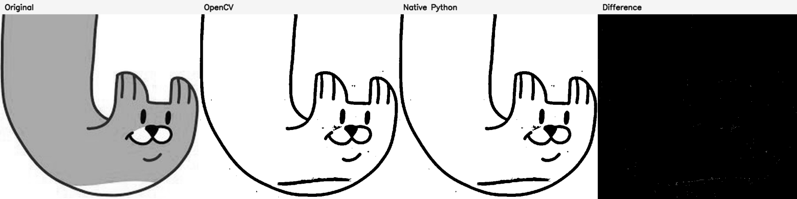
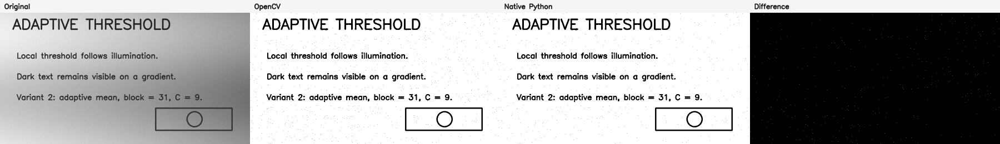

# Лабораторная работа №1. Вариант 2

Тема работы - бинаризация изображения с адаптивным порогом.

Я сделал два варианта одного алгоритма:

- через готовую функцию OpenCV;
- самостоятельно на Python.

В обоих случаях порог считается по среднему значению яркости в окрестности
пикселя (`adaptive mean`).

## Цель работы

Разобраться, как работает адаптивная бинаризация, реализовать её двумя
способами и сравнить полученные результаты.

## Немного теории

После бинаризации в изображении остаются только чёрные и белые пиксели.
Обычный глобальный порог один для всего кадра, поэтому при неравномерном
освещении часть изображения может потеряться.

Адаптивный порог рассчитывается отдельно для каждого пикселя:

```text
T(x, y) = среднее значение в окрестности - C
```

Если яркость пикселя больше `T`, он становится белым, иначе - чёрным.

Формально бинаризация записывается так:

```text
dst(x, y) = 255, если src(x, y) > T(x, y)
dst(x, y) =   0, если src(x, y) <= T(x, y)
```

Параметры алгоритма:

- `block_size` - размер окрестности пикселя. Значение должно быть нечётным;
- `C` - число, которое вычитается из локального среднего.

В собственной версии локальные суммы считаются через интегральное изображение.
Каждый его элемент хранит сумму пикселей прямоугольника от начала изображения до
текущей позиции:

```text
I(x, y) = src(x, y) + I(x - 1, y) + I(x, y - 1) - I(x - 1, y - 1)
```

Сумма произвольного прямоугольника после этого находится по четырём значениям
интегрального изображения. Без такой оптимизации для каждого пикселя пришлось бы
заново обходить всё окно `block_size × block_size`.

Сложность прямого подхода составляет
`O(height × width × block_size²)`. Построение интегрального изображения и
последующая бинаризация требуют `O(height × width)` операций.

## Как устроена программа

Вся основная логика находится в `adaptive_threshold.py`:

- `adaptive_threshold_opencv` - вариант через OpenCV;
- `adaptive_threshold_native` - собственная реализация;
- `run_benchmark` - запуск и замер времени;
- `save_results` - сохранение изображений;
- `create_demo_image` - создание тестового изображения, если своё не указано.

Собственная версия строит интегральное изображение и выполняет сравнение пикселей
обычными циклами Python. NumPy используется только как формат входного и выходного
изображения. Готовые функции бинаризации, `np.cumsum`, `np.pad` и `np.where` в
собственном алгоритме не применяются.

Общая архитектура программы:

```text
Загрузка файла / создание демонстрационного изображения
                         |
                         v
              Изображение в оттенках серого
                         |
              +----------+----------+
              |                     |
              v                     v
     cv2.adaptiveThreshold    Native Python
                              integral image
              |                     |
              +----------+----------+
                         |
                         v
        Сравнение результатов и измерение времени
                         |
                         v
              Сохранение изображений
```

## Запуск

Проект проверялся на Python 3.13, но должен работать начиная с Python 3.10.

Создание окружения и установка библиотек:

```powershell
python -m venv .venv
.\.venv\Scripts\python.exe -m pip install -r requirements.txt
```

Запуск на встроенном примере:

```powershell
.\.venv\Scripts\python.exe adaptive_threshold.py
```

Чтобы обработать своё изображение, нужно указать реальный путь к нему:

```powershell
.\.venv\Scripts\python.exe adaptive_threshold.py --input "C:\Users\User\Pictures\photo.jpg" --block-size 31 --c 9
```

Если файл лежит рядом с программой, достаточно его имени:

```powershell
.\.venv\Scripts\python.exe adaptive_threshold.py --input photo.jpg
```

Готовые изображения сохраняются в папку `results`:

- `input.png` - исходное изображение;
- `opencv.png` - результат OpenCV;
- `native.png` - результат собственной версии;
- `difference.png` - разница между результатами;
- `comparison.png` - всё сравнение на одной картинке.

## Результаты

### Изображение с котом

Для изображения с котом размером 640 × 640 пикселей использовались
`block_size = 31` и `C = 9`.



Слева направо: исходное изображение, результат OpenCV, результат собственной
реализации и карта различий. Чёрный цвет на карте означает совпадение результатов,
белые точки - пиксели, для которых реализации выбрали разные значения.

Совпало **99,9482% пикселей**: отличаются **212 из 409 600**. Сохранённые результаты
проверены повторным запуском обеих реализаций с теми же параметрами.

Серая заливка кота становится белой, потому что порог рассчитывается относительно
локального среднего. Внутри почти однородной серой области яркость пикселя близка
к среднему и превышает порог `среднее − 9`. Тёмные контуры при этом сохраняются.

### Демонстрационное изображение

Для проверки использовалось изображение размером 900 × 520 пикселей,
`block_size = 31` и `C = 9`.



Каждая реализация запускается пять раз. В качестве результата используется
медиана измерений: в отличие от выбора самого быстрого запуска, она меньше зависит
от случайных скачков нагрузки системы.

На моём компьютере получились примерно такие значения:

| Реализация | Время |
|---|---:|
| OpenCV | 1,3 мс |
| Собственная | 212,8 мс |

Совпало **99,9169% пикселей**. Небольшое отличие видно на карте разницы и
связано с округлением среднего значения. OpenCV заметно быстрее, потому что
внутри используется оптимизированный код на C++, а собственная версия намеренно
выполняет алгоритм обычными циклами Python.

Время может немного меняться при каждом запуске и зависит от компьютера.

### Почему OpenCV и собственная реализация немного отличаются

В собственной реализации среднее вычисляется как `local_sum / area` и сохраняет
дробную часть. OpenCV в режиме `ADAPTIVE_THRESH_MEAN_C` сохраняет локальное среднее
в 8-битном изображении, поэтому оно округляется до целого перед сравнением.
Это видно в [исходном коде OpenCV](https://github.com/opencv/opencv/blob/4.x/modules/imgproc/src/thresh.cpp).

Например, на изображении с котом у пикселя с координатами `x = 315`, `y = 0`
(отсчёт от нуля) яркость равна `243`, а локальное среднее - примерно `251,9594`.
При `C = 9` собственная версия получает порог `242,9594`: пиксель становится белым,
так как `243 > 242,9594`. OpenCV округляет среднее до `252` и получает порог `243`:
пиксель становится чёрным, так как строгое условие `243 > 243` не выполняется.

На этом изображении все 212 расхождений объясняются округлением среднего:
порог по округлённому среднему полностью воспроизводит результат OpenCV,
а порог по дробному среднему - результат собственной реализации.

## Проверка

Тесты запускаются командой:

```powershell
.\.venv\Scripts\python.exe -m pytest -q
```

Они проверяют формат результата, работу на однородном и заранее известном малом
изображении, неверные параметры и совпадение с OpenCV. Сейчас проходят все 9
тестов.

## Исследование параметров

| Изменение | Наблюдаемая закономерность |
|---|---|
| Увеличение `block_size` | Порог учитывает более крупную область, поэтому мелкие локальные изменения освещения влияют меньше |
| Уменьшение `block_size` | Алгоритм сильнее реагирует на небольшие локальные изменения |
| Увеличение `C` | Порог уменьшается, поэтому больше пикселей становятся белыми |
| Уменьшение `C` | Порог увеличивается, поэтому белых пикселей становится меньше |

## Вывод

Адаптивный порог лучше обычного подходит для изображений с разным уровнем
освещения. Чем больше `block_size`, тем по большей области усредняется яркость.
При увеличении `C` больше пикселей становятся белыми.

Обе реализации дали почти одинаковый результат. Собственная версия показывает
принцип работы алгоритма, а вариант OpenCV лучше использовать на практике из-за
скорости.

## Источники

1. [OpenCV: Image Thresholding](https://docs.opencv.org/4.x/d7/d4d/tutorial_py_thresholding.html)
2. [OpenCV: adaptiveThreshold](https://docs.opencv.org/4.x/d7/d1b/group__imgproc__misc.html)
3. F. C. Crow. *Summed-area tables for texture mapping*. SIGGRAPH, 1984.
